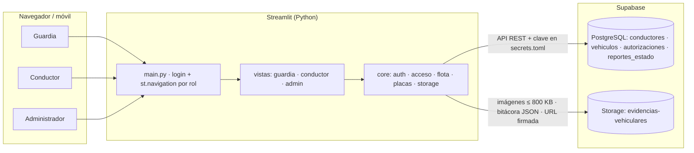
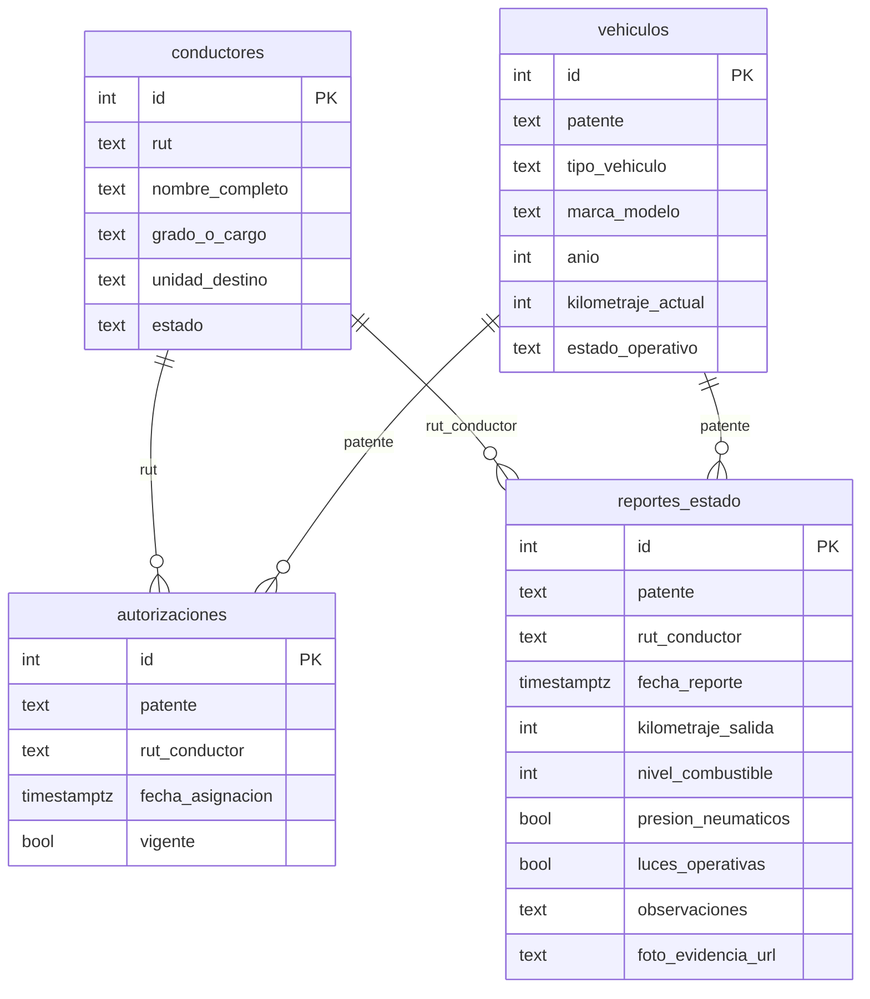
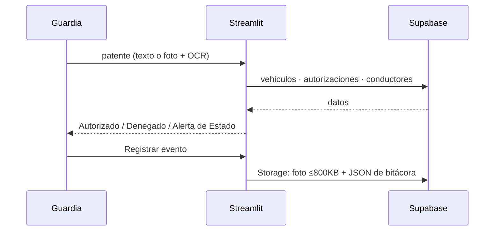
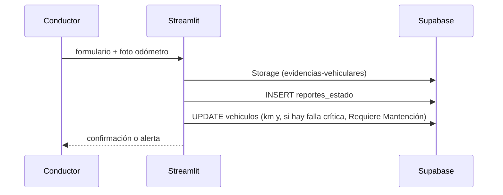

# Informe técnico — Sistema de Control de Flota

## 1. Arquitectura

**Decisiones de arquitectura**
- *Streamlit con módulos por perfil*: un solo despliegue, interfaz responsive para móvil; cada rol solo ve sus vistas.
- *Solo las 4 tablas del enunciado*: el proyecto Supabase es el entregado por el profesor y se accede con su clave
  por API (sin acceso SQL). Por eso las reglas viven en la capa `core/` de Python y no en triggers de la BD.
  `sql/00_esquema_base.sql` (script del profesor) reconstruye las 4 tablas con sus datos y
  `sql/01_opcional_reglas_en_bd.sql` lleva las mismas reglas a la BD (trigger, función, vista) si hubiese acceso SQL.
- *Secretos fuera del repositorio*: la clave de Supabase y los hashes de contraseña viven en `.streamlit/secrets.toml`
  (en `.gitignore`); en el despliegue se pegan en *Settings → Secrets*.
- *Imágenes ≤ 800 KB*: cada foto se redimensiona y recomprime a JPEG antes de subir (el bucket impone el mismo límite).
- *Bitácora de accesos en Storage*: al no poder crear una tabla `registros_acceso`, cada evento del guardia se guarda como
  objeto JSON (`accesos/AAAA-MM-DD/<hora>_<patente>_<id>.json`) junto a su foto; la analítica y la auditoría los leen de ahí.
  Limitación: es adecuado para el volumen del curso; en producción correspondería una tabla indexada.

**Políticas de acceso del bucket `evidencias-vehiculares`**

| Aspecto | Configuración |
|---|---|
| Visibilidad | **Privado** (no público): ninguna imagen ni JSON se puede abrir con una URL directa. |
| Tamaño máximo por objeto | 800 KB (la app además recomprime cada foto a JPEG antes de subirla). |
| Tipos permitidos | `image/jpeg`, `image/png`, `image/webp` (fotos) y `application/json` (bitácora de accesos). |
| Escritura / lectura | Solo el servidor Streamlit, con la *secret key* de Supabase guardada en `secrets.toml`; el navegador nunca recibe esa clave. |
| RLS (Row Level Security) | Activo en el proyecto; no se crean políticas públicas sobre `storage.objects`, de modo que la clave anónima no puede leer ni escribir. |
| Visualización | La app genera una **URL firmada** temporal (1 hora) cada vez que un administrador abre una foto. |
| Estructura | `patentes/<patente>/…` (foto del guardia), `odometros/<patente>/…` (foto del conductor), `accesos/AAAA-MM-DD/…` (bitácora). |

Control de acceso a nivel de aplicación: guardia, conductor y administrador ven vistas distintas (`st.navigation` por rol),
y solo el administrador puede abrir fotos y bitácora. Limitación: la seguridad descansa en la *secret key*; si se filtra,
da acceso total al proyecto, por eso `secrets.toml` está en `.gitignore`.

## 2. Modelo de datos

### ¿Qué tiene cada tabla?
| Tabla | Contenido |
|---|---|
| `conductores` | 30 conductores: RUT, nombre, grado/cargo, unidad de destino, estado (Activo) |
| `vehiculos` | 15 vehículos: patente, tipo, marca/modelo, año, kilometraje, estado operativo (`Operativo` / `Requiere Mantención` / `Crítico`) |
| `autorizaciones` | Vínculo patente ↔ conductor con bandera `vigente` y fecha de asignación (un vehículo puede tener varios conductores autorizados) |
| `reportes_estado` | Check-in del conductor: km, combustible, neumáticos (OK/no), luces (OK/no), observaciones con etiquetas críticas, ruta de la foto del odómetro |

Las relaciones patente/RUT son llaves foráneas sobre claves naturales únicas (`ON UPDATE/DELETE CASCADE`, ver `00_esquema_base.sql`). Estados de conductor: Activo, Suspendido, En Comisión (solo `Activo` puede conducir). Las columnas `foto_evidencia_url` guardan la **ruta** dentro del
bucket; la URL firmada se genera al visualizar.

## 3. Preguntas del dominio

**¿Cómo se estructuró la consulta para validar simultáneamente conductor y vehículo?**
`core/acceso.py::validar_acceso` encadena tres consultas REST sobre las tablas existentes: (1) `vehiculos` por patente
normalizada (existencia y estado), (2) `autorizaciones` con `patente = X AND vigente = true`, (3) `conductores` con
`rut IN (ruts autorizados)`. Luego resuelve por conductor, en orden: patente inexistente → *Denegado*; sin autorización
vigente → *Denegado*; conductor no `Activo` → *Denegado*; vehículo distinto de `Operativo` → *Alerta de Estado*;
en otro caso → *Autorizado*. Si hay varios conductores autorizados, el guardia elige quién ingresa. (Equivalente SQL de una
sola consulta: `vehiculos LEFT JOIN autorizaciones LEFT JOIN conductores`, en el script opcional.)

**¿Qué lógica automatizada pasa el vehículo a "Requiere Mantención"?**
`core/flota.py::registrar_reporte`: el formulario del conductor marca como críticos *frenos en falla* y *presión de
neumáticos severamente baja* mediante las etiquetas `[CRÍTICO:FRENOS]` / `[CRÍTICO:NEUMATICOS]` en `observaciones`. Tras insertar
el reporte, la función actualiza `vehiculos`: `kilometraje_actual = max(actual, reportado)` y, si hay motivo crítico y el
vehículo estaba `Operativo`, `estado_operativo = 'Requiere Mantención'`. La app informa al conductor del cambio.

**¿Cómo se gestionan sesión y perfiles en Streamlit?**
`core/auth.py` valida credenciales y guarda el usuario en `st.session_state`. Guardia y administrador están definidos en
`secrets.toml` (hash PBKDF2-SHA256 con sal); el conductor entra con su RUT (debe existir y estar `Activo` en `conductores`) y la
clave común de conductores. `main.py` construye el menú con `st.navigation` **según el rol**, de modo que cada perfil solo
tiene registradas sus páginas; además cada vista llama `exigir_rol(...)` (defensa en profundidad). Hay bloqueo tras 5
intentos fallidos por sesión y cierre de sesión que limpia el estado.

## 4. Flujos de datos

## 5. Capturas de validación (completar tras ejecutar)
- [ ] Login y menú por cada rol
- [ ] Guardia: resultado *Autorizado*, *Denegado* y *Alerta de Estado*
- [ ] Conductor: reporte con frenos en falla → vehículo pasa a *Requiere Mantención*
- [ ] Panel BI: disponibilidad, inmovilizadas y matriz verde/amarillo/rojo
- [ ] Feed cronológico de accesos con fotografías (Monitoreo)
- [ ] Analítica y Auditoría (foto desde Storage)
- [ ] Supabase: tablas, bucket `evidencias-vehiculares` y `secrets.toml` fuera del repositorio
